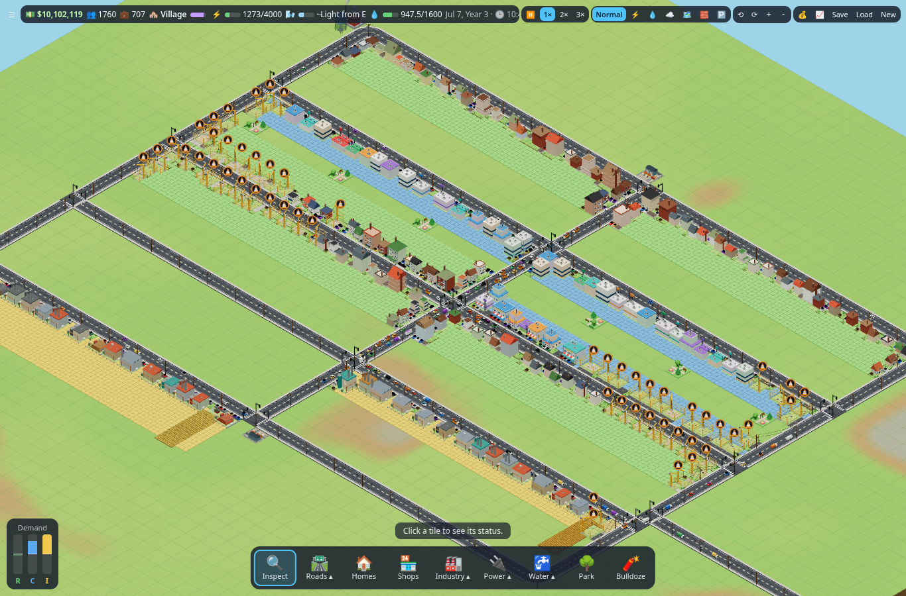

# Low-Poly City

A browser-based isometric low-poly city builder built with **Vite + TypeScript + Three.js**.
Zone land, lay roads, run power and water networks, balance a budget, and watch
traffic, industry and the day/night cycle bring your city to life.



## Run it locally

```bash
npm install
npm run dev      # dev server at http://localhost:5173
npm run build    # type-check + production build into dist/
```

## How to play
1. Lay a **Road**. Every building needs a road on one of its four sides.
2. Build a **Coal Plant** (5,000 power) or **Wind Turbine** (up to 1,000, varies with the wind) and drag **Power Lines** past where you'll build.
3. Build a **Water Tower** (80 water, needs power to pump) and drag **Pipes** past the same blocks.
4. Paint **Homes / Shops / Industry** zones beside the road. Lots grow into buildings over time once they have road + power + water.
5. Watch your 💵 cash. Everything costs money, bulldozing refunds 25%, and each month operating buildings pay taxes while plants, turbines and towers cost upkeep. Open **💰 Budget** to see the books and set tax rates (0–20%; higher taxes slow growth).
6. Watch the ⚡ and 💧 meters. If demand passes capacity, the furthest buildings go dark (outage) and get a warning gem.
7. Industry ships **goods by truck** to shops — keep the roads flowing or shelves go empty.
8. Cars drive the roads for real: signals, parking and congestion all matter.

## Controls
| Action | Mouse / keys | Touch |
|---|---|---|
| Use tool | Left-click / drag | One finger |
| Pan | Right or middle drag, WASD / arrows | Two fingers (or one finger with Inspect) |
| Zoom | Wheel, + / − | Pinch |
| Rotate 90° | Q / E | ⟲ ⟳ buttons |
| Pause | Space | ⏸ |
| Tools | I R 1 2 3 P N L T O X | toolbar |

## Features
- **Simulation:** zone growth, power/water networks with capacity outages, traffic with signals and parking, industrial goods, pollution & desirability, variable wind, economy with taxes and upkeep, save/load.
- **Presentation:** day/night cycle with lit windows and lamp glows, seasons-ready palette, procedural low-poly models, sound effects, population graphs, demand bars, game log and notifications.
- **Rendering:** every model is procedural — primitives merged into single vertex-colored geometries, drawn as instanced meshes with flat shading. Detail comes from procedural canvas textures (surface grain, grass, icon badges, light halos). No model files, no art pipeline.

## Code layout
```
src/sim/     the city as plain data + rules (no graphics) — grid, growth, networks,
             traffic, economy & goods, environment (wind, pollution), save
src/render/  Three.js drawing (reads the sim, never changes it) — cityRenderer,
             camera, scene, models, buildings, industryModels, roads, vehicles,
             nature, powerLines, dayNight, instancing
src/ui/      HTML toolbar/panels and input — hud, tools, input, graphs, gameLog,
             notifications, menu, demandBars
src/main.ts  wires the layers together and runs the game loop
src/audio/   procedural sound effects
```
Every file starts with a comment explaining its job; see the wiki for longer explanations.

## Version 1.5

Version 1.5 is being built on the `version-1.5` branch. So far it includes:

- **1.5-a graphics polish (folded in):** a procedural grass texture on the
  ground, a fine grain texture on the shared building material, and extra
  industry props. Both textures use the game's seeded RNG with fixed seeds, so
  they look identical on every reload and for every player.
- **WASD after returning to the tab:** camera keys work right away after you
  switch back to the game; no click needed.
- **Update prompt and title screen**, with save slots and export/import.
- **Power tiers:** coal, oil and nuclear plants.
- **Parking:** grown parking garages and a coverage overlay.
- **Housing:** mixed-use blocks and medium-density housing levels 6–7.
- **Traffic:** right on red, 2×2 roundabouts, and true four-lane avenues where cars pick a lane for their turn and change lanes. Avenues unlock at 250 people.
- **Industry:** businesses that match their resource patch, and goods chains (lumber, materials, furniture, fuel, plastics, electronics).
- **Economy:** profit for each building, land value, and a property tax.
- **Redevelopment:** struggling buildings are rebuilt based on their health, and shops and garages can swap.
See the wiki page *Version 1.5* for details.

## Version 1.5b
Version 1.5b is on the same branch (`version-1.5`):
* **Residential:**
  * Mid-rise apartments at L6 and L7, and larger merged footprints.
  * Detail on every side of the building.
  * Under sustained high demand, homes densify and the zoning upgrades to match.
  * Empty residential zoning cools R demand.
* **Services:**
  * A 2×2 landfill (unlocks at 1,000 people) with garbage trucks. It has a finite capacity: its model grows through six stages as it fills, a compactor and gulls work on it, and once it is full it stops taking garbage until you build a new one.
  * Recycling center (unlocks at 2,500 people): buildings around it make up to 45% less garbage. It runs 12 garbage trucks (double a landfill) and burns the garbage for 5,000 power, like a coal plant. Landfill trucks haul stored garbage to it to be burned, freeing landfill space.
  * Police and crime: a detailed 2×2 police station; police, the high school and crime all start at 2,500 people.
  * In-game change log ("What's new"): add an entry to `src/changelog.ts` for each update; it opens automatically after an update and from the title screen / ☰ menu.
  * Clinic, hospital and ambulances.
  * Schools: elementary is available from the start. Workforce education matters.
* **Offices:** Commercial ▸ Office zoning, with law firms, cable and internet companies, data centres, cell towers and radio stations.
* **Industry:**
  * A detailed 2×2 coal plant (5,000 power) and a detailed 2×2 oil plant (8,000), plus a 2×2 elementary school; crime starts when police unlock at 2,500 people.
  * Procedurally textured industrial models.
  * Factories reach L5, and industry merges and redevelops more often.
  * Six new industry types: warehouse, chemical plant, steel mill, textile mill, bottling plant and assembly plant.
  * Tanker and dump trucks.
* **Shipping Depot:** industry and shops in its catchment ship through it.
* **Water:** a large water tower tier (3,200 water, unlocks at 5,000 people).
* **Traffic:** the right-on-red throughput fix.
* Run the tests with `npm run test:v15b`, `test:v15b-res`, `test:v15`, `test:cells` and `test:industry`. `npm run balance` prints the rebalance probe.
* See the wiki page *Version 1.5b*.

## Roadmap
- ✅ **Milestones 1–2:** grid, isometric camera, placement tools, utilities, zone growth, save/load, building variety, terrain & trees, money and budget.
- ✅ **Traffic:** cars on real road graphs, traffic signals, parking, congestion.
- ✅ **Environment:** day/night cycle, variable wind, pollution & desirability, parks.
- ✅ **Economy:** industrial goods shipped by truck, construction system, progression.
- **Next:** see the wiki's upcoming-features page for proposed designs.
