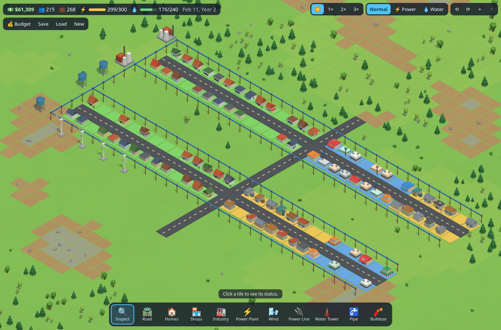

# Low-Poly City

A browser-based isometric low-poly city builder built with **Vite + TypeScript + Three.js**.
Zone land, lay roads, power lines and water pipes, and keep your city's power and water networks running.



## Run it locally

```bash
npm install
npm run dev      # dev server at http://localhost:5173
npm run build    # type-check + production build into dist/
```

## How to play
1. Lay a **Road**. Every building needs a road on one of its four sides.
2. Build a **Power Plant** (120 power) or **Wind Turbine** (15) and drag **Power Lines** past where you'll build.
3. Build a **Water Tower** (80 water, needs power to pump) and drag **Pipes** past the same blocks.
4. Paint **Homes / Shops / Industry** zones beside the road. Lots grow into buildings over time once they have road + power + water.
5. Watch your 💵 cash. Everything costs money, bulldozing refunds 25%, and each month operating buildings pay taxes while plants, turbines and towers cost upkeep. Open **💰 Budget** to see the books and set tax rates (0–20%; higher taxes slow growth).
6. Watch the ⚡ and 💧 meters. If demand passes capacity, the furthest buildings go dark (outage) and get a warning gem.

## Controls
| Action | Mouse / keys | Touch |
|---|---|---|
| Use tool | Left-click / drag | One finger |
| Pan | Right or middle drag, WASD / arrows | Two fingers (or one finger with Inspect) |
| Zoom | Wheel, + / − | Pinch |
| Rotate 90° | Q / E | ⟲ ⟳ buttons |
| Pause | Space | ⏸ |
| Tools | I R 1 2 3 P N L T O X | toolbar |

## Code layout
```
src/sim/     the city as plain data + rules (no graphics)  — grid, rules, networks, simulation, economy, terrain, random, save
src/render/  Three.js drawing (reads the sim, never changes it) — camera, scene, models, buildings, nature, instancing
src/ui/      HTML toolbar/panels and input                    — hud, input, tools
src/main.ts  wires the layers together and runs the game loop
```
Every file starts with a comment explaining its job; see the wiki for longer explanations.

## Roadmap
- **Milestone 1:** grid, isometric camera, placement tools, utilities, zone growth, save/load. ✅
- **Milestone 2:** building variety, terrain & trees, money and budget. ✅
- **Next:** car traffic (A* pathfinding, traffic lights, settings for car count).
- **Milestone 3:** economy (industrial goods shipped by truck to commercial), polish.
